# a. Executive summary

1. Bengaluru's evening PM2.5 climbs from about 18:00 and most often peaks between 19:00 and 22:00
   (typical peak 20:00); every day of the week is about the same, but the dry months
   (November, March, April are worst) and Deepavali night are far worse than the monsoon.
2. Rain does **not** delay the peak: compared with dry evenings in the same month and day type, rainy evenings
   peak about 29% lower and 0.8 hours earlier,
   although rainy days are already cleaner by noon, so this is an association with rainy weather, not proof
   that rain itself cleans the air.
3. We recommend that the city issue its evening pollution alerts by 18:00 for the 19:00 to 22:00 window,
   concentrate them on dry evenings from November to April and on festival nights, and not plan separate
   weekday-specific or later "rainy-day" alert times.


# b. Question and why it matters to the city

**Question.** Does rain delay, flatten or worsen Bengaluru's evening PM2.5 peak, and on which weekdays and
months is the evening pollution rush worst?

**Why it matters.** Every evening, office traffic, delivery riders and home cooking add to the city's air at
the same time as the air near the ground stops mixing upwards after sunset. PM2.5 (fine dust and smoke
particles, small enough to reach the lungs) is the pollutant that matters most for health. The Urban Services
Cell can act on this in three ways:

* **Pollution alerts:** at what time of day, in which months and on which days to warn residents.
* **Rain-day rules:** whether rules for delivery riders and staggered office hours on rainy days also need to
  change the timing of pollution measures.
* **Where to measure:** which parts of the city the current monitors cannot see.

**Scope.** 2,040 usable station-evenings from 7 official monitors,
2025-10-01 to 2026-11-20 (over 13 months of hourly data). "Evening" means 17:00 to 23:00 Indian Standard
Time (IST).


# c. Data inventory and V profile

**Source register.** Four sources: two JSON APIs, one calendar we built by hand, and one text-derived
source (search interest).

| Source | URL | Method | Terms of use | Accessed (UTC) |
|---|---|---|---|---|
| OpenAQ v3 API | https://api.openaq.org/v3 | API (JSON), scripts 01/02, key in .env, month windows, cached | https://docs.openaq.org/about/terms | 2026-11-26 |
| Open-Meteo Historical Weather API | https://archive-api.open-meteo.com/v1/archive | API (JSON), script 03, timezone=GMT, cached | https://open-meteo.com/en/terms | 2026-11-26 |
| Karnataka general holidays 2025 (DPAR 16 HHL 2024) and 2026 (DPAR 16 HHL 2025) + central list 2026 | https://cag.gov.in/uploads/media/Karnataka-State-Holidays-2025-067764409e26023-56493682.pdf ; https://kea.co.in/wp-content/uploads/2025/11/Circular-No-089-2025-KARNATAKA-GOVERNMENT-HOLIDAYS-FOR-THE-YEAR-2026.pdf ; https://cag.gov.in/uploads/media/Holiday-List-2026-069521fe6f358d0-89936988.pdf | Typed in by hand (04_build_calendar.py), checked date by date in M6 -> calendar_verified.csv | Government publication | 2026-11-26 |
| Google Trends (Karnataka): bangalore traffic / bangalore rain / AQI bangalore | https://trends.google.com/trends/explore | Manual CSV export (M7); no scraping | https://policies.google.com/terms | 2026-11-26 |

**Data inventory.** Every field we use (33 in all), grouped by table and level of
measurement; the full inventory with an example value per field is in Appendix A. The AQI category (Good to
Severe) is **ordinal**: its categories have an order, but the steps between them are not equal.

| Table | Level | Fields | Structure |
|---|---|---|---|
| stations | nominal | station_id, name, operator, openaq_location_id | structured |
| stations | continuous | lat, lon | structured |
| readings | continuous | ts_ist, value | semi-structured |
| readings | nominal | parameter, unit, qc_flag, is_filled | semi-structured / structured |
| readings | discrete | observed_count | semi-structured |
| weather_hourly | continuous | ts_ist, precip_mm, rain_mm, temp_c, rh_pct, wind_kmh, blh_m | semi-structured |
| weather_hourly | nominal | is_rain_hour | structured |
| calendar | continuous | date | structured |
| calendar | ordinal | weekday | structured |
| calendar | nominal | is_holiday, holiday_name, is_long_weekend, is_festival, season | structured / unstructured |
| analysis | ordinal | aqi_category | structured |
| analysis | continuous | pm25_z | structured |
| analysis | discrete | peak_hour | structured |
| analysis | nominal | evening_type | structured |
| trends | discrete | search_interest | structured |

**V profile.**

| Source | Rows | Raw MB | Clean MB | Format |
|---|---|---|---|---|
| OpenAQ hourly readings | 204,584 | 193.2 | 1.4 | JSON (nested records) -> parquet |
| Open-Meteo weather | 9,984 | 0.5 | 0.15 | JSON (parallel arrays) -> parquet |
| Calendar | 416 | 0.0 | 0.05 | CSV built by hand |
| Full analysis grid (readings_clean) | 279,552 | 0.0 | 1.4 | parquet (also MySQL table readings) |

**OpenAQ hourly readings:** 28 series x 1 value/hour = 28 new values/hour (112 raw 15-min readings/hour behind them); newest reading 1.8 h old when we downloaded; **Open-Meteo weather:** 1 row/hour for the city; archive published with a delay of a few days; **Calendar:** 1 row/day; fixed once a year by government notification; **Full analysis grid (readings_clean):** every station x pollutant x hour, gaps included as empty rows

**Volume.** 204,584 hourly air-quality rows from 7 stations over 14 months, 193.2 MB of raw JSON in 392 API pages. The full hourly grid (with gaps as empty rows) is 279,552 rows.
**Velocity.** The network adds 28 new hourly values every hour for our stations (each built from four 15-minute readings), and OpenAQ's newest reading was 1.8 hours old when we downloaded. That speed is why collection was written as resumable month-by-month pulls with a cache, not a one-off download.
**Variety.** Two JSON shapes (OpenAQ nested records; Open-Meteo parallel arrays), a hand-built CSV calendar and a manual Trends CSV, with three clocks (UTC with 'Z', IST with '+05:30', and zone-less GMT).
**Which V dominated?** Velocity and Variety shaped the work more than Volume. Volume is real but modest: our largest table fits in memory on a laptop, so PySpark was not strictly required at this size. We used PySpark and parquet because the same job scales unchanged to more stations, 15-minute data and more years, and because parquet keeps types (timestamps) intact between tools. Variety, especially the time zones, took most of the cleaning effort.


# d. Pipeline: how data moves from source to chart

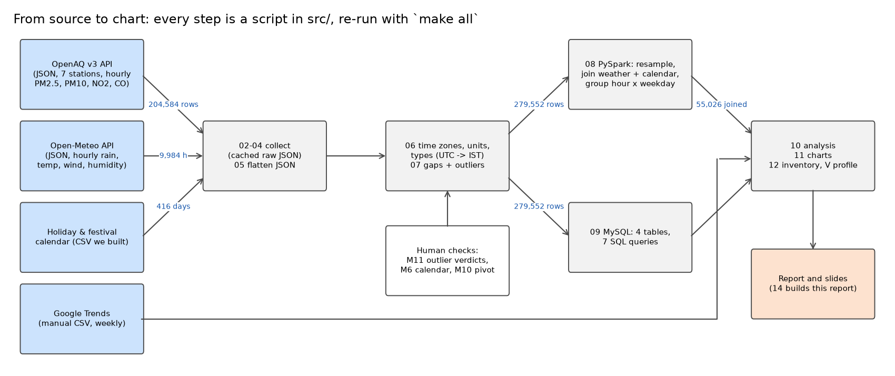{width=16cm}

Each box is one numbered script in `src/`; `make all` re-runs everything from the cached raw downloads to
the charts and this report. In plain words:

1. **Collect** (01 to 04): ask both APIs for every hour, one month at a time, keeping a copy of each answer.
2. **Flatten** (05): turn nested JSON (lists inside lists) into ordinary tables, one value per cell.
3. **Fix time and units** (06): convert every clock to Indian time, line up weather and air-quality hours,
   and convert NO2 and CO to the units the Indian AQI uses.
4. **Clean** (07): count every missing hour, remove broken-sensor readings, keep real extreme events, fill
   only short gaps (section e).
5. **Big-data step** (08, PySpark). Resample to hourly, join air with weather and the calendar, and group by
   hour and weekday. Row counts before and after each stage:

| Stage | What happens | Rows | Seconds |
|---|---|---|---|
| 1_load | Load readings_clean (full station x parameter x hour grid) | 279,552 | 1.9 |
| 2_clean | Drop missing hours and QC failures (real events kept) | 213,940 | 0.3 |
| 3_resample | Resample to hourly (date_trunc + avg) per station x parameter | 213,940 | 1.0 |
| 4a_pm25 | PM2.5 station-hours only | 55,026 | 0.3 |
| 4b_join | PM2.5 ⋈ weather_hourly ⋈ calendar (left joins) | 55,026 | 0.6 |
| 5a_hour_weekday | GROUP BY weekday x hour (heatmap) | 168 | 0.2 |
| 5b_month_hour | GROUP BY month x hour | 336 | 0.2 |
| 5c_rain_hour | GROUP BY rain/dry x hour | 48 | 0.4 |

6. **Database** (09, MySQL). Load the same data into 4 linked tables and run 7 SQL queries,
   including JOINs and GROUP BYs (ER diagram and queries in Appendix B).

| MySQL table | Rows | Columns |
|---|---|---|
| stations | 7 | 6 |
| weather_hourly | 9,984 | 8 |
| calendar | 416 | 7 |
| readings | 279,552 | 8 |

7. **Analyse and draw** (10 to 12): compute every number in this report and draw the charts.


# e. Cleaning log

The full log has 40 rows, one per decision, each with its reason (Appendix A). The key decisions are
below; each rule is justified underneath.

| Topic | Problem found | Rows | Action taken | Log # |
|---|---|---|---|---|
| Time zones | UTC timestamps (text) | 204,584 | Parsed, converted to IST; checked: 0 mismatches | 7 |
| Time alignment | Weather hours start at :30 IST | 9,984 | Lined up with air hours (mid-hour value; rain split half/half) | 15 |
| Type casting | Values that are not numbers | 0 | pd.to_numeric, then float | 10 |
| Units | NO2 / CO in ppb | 51,290 / 48,952 | Converted to µg/m³ / mg/m³ (25 °C, 1 atm) | 11 |
| Missing values | Hours never sent | 75,136 | Counted per station (Appendix A) | 18 |
| Missing values | Gaps of 1-3 hours | 12,612 | Forward-filled, flagged is_filled | 32 |
| Missing values | Gaps over 3 hours | 65,152 | Left empty | 33 |
| Missing values | Evenings with < 6 of 7 real hours | 872 | Not used for peak timing | 34 |
| Missing values | Missing rain hours | 1 | Never filled | 36 |
| Outliers: failure | Exact zeros | 877 | Blanked | 23 |
| Outliers: failure | Flat-lines (>= 6 h same value) | 1,720 | Blanked | 24 |
| Outliers: failure | Isolated 1-hour spikes | 10 | Blanked | 25 |
| Outliers: real | Festival-night extremes | 145 | Kept, flagged | 26 |
| Outliers: real | City-wide extremes (3+ stations) | 65 | Kept, flagged | 28 |
| Outliers: human (M11) | Top 10 unexplained PM2.5 values | 21 / 5 | Failure episodes blanked / real ones kept | 30 |

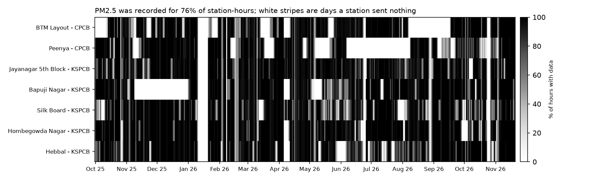{width=15cm}

**Why these rules.**

* **Missing values.** We count every gap first (per station: Appendix A and `gaps_per_station.csv`).
  The longest PM2.5 gap is 1,491 hours at BLR5607. In late
  January 2026 all seven stations went silent for about two weeks together, which points to a data-feed
  outage rather than broken sensors. Pollutant gaps of up to 3 hours are forward-filled (the last value is
  repeated), because PM2.5 changes slowly from hour to hour; longer gaps stay empty, because filling them
  would be guessing. Smooth weather (temperature, humidity, wind) is interpolated for up to 3 hours. Rain is
  never filled, because a shower starts and stops suddenly. An evening counts for peak timing only if at least
  6 of its 7 hours are real readings, so a filled hour can never be the "peak".
* **Time zones.** OpenAQ sends UTC times; we convert to IST and check the result against OpenAQ's own
  local-time copy (0 mismatches). Open-Meteo hours start at half past the hour in IST, so we line them up
  before joining; a naive join would pair every air reading with weather from 30 minutes earlier.
* **Type casting.** Values are forced to numbers (`pd.to_numeric`); anything that is not a number becomes
  missing instead of breaking an average. NO2 and CO arrive in ppb and are converted at 25 °C and 1 atm.
* **Outliers.** A sensor failure (exact zero, the same value stuck for 6 hours or more, a single-hour spike
  that jumps and falls straight back, or a value outside the analyser's range) is blanked. A real extreme
  event is kept: festival nights, city-wide highs at 3 or more stations, and heavy rain. A person reviewed
  the 10 largest unexplained PM2.5 values (M11): 9 were judged sensor
  failures and 1 a real event, by looking at the build-up over hours, the other
  stations and the calendar.
* **Normalisation.** Stations differ in level (a busy junction reads higher than a park), so when we compare
  rainy and dry evenings across stations we use **z-scores** within each station: 0 is that station's own
  average, and +1 is one standard deviation above it (chart 2).


# f. Findings

**Finding 1: the evening rush is real, and it looks the same every day of the week.**
Across the city, PM2.5 is lowest in the afternoon (around 15:00, 27.9 µg/m³ on
average) and highest in the evening (around 21:00, 37.2 µg/m³). Looking at each
station-evening separately, 65.3% of peaks fall between 19:00 and 22:00, with a typical
peak at 20:00. But 25.1% of evenings have no clear
peak: PM2.5 is still rising at 23:00, as the night-time air traps pollution near the ground.

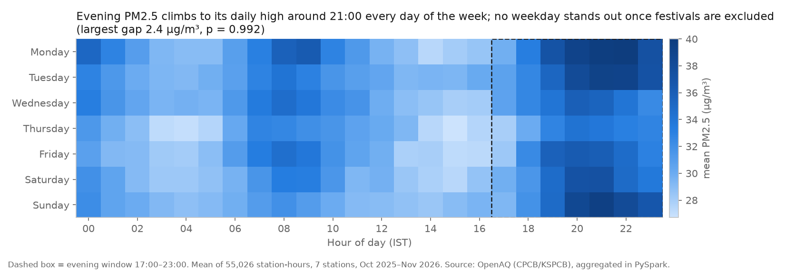{width=16cm}

Before excluding festivals, Monday looked worst (36.6 µg/m³) and Thursday best
(32.0), but both Deepavalis fall on or next to a Monday. With the
19 festival dates removed, the gap between the highest and lowest weekday
shrinks to 2.4 µg/m³, and a permutation test (shuffling which weekday each date
belongs to, 1,000 times) gives p = 0.992: a gap this size appears by chance almost every time. All seven
weekdays lie between 33.1 to 35.5 µg/m³. **No weekday stands out.**

**Finding 2: rain does not delay the evening peak; rainy evenings peak lower and earlier.**
We compared rainy evenings (at least 1 mm of rain between 16:00 and 22:00) with dry ones (no rain from noon
to midnight) **inside the same month and the same day type** (working day or weekend/holiday), so the
monsoon season itself does not create the difference. Across 409 rainy and
1027 dry station-evenings (79 rainy dates, 15
month-by-day-type groups), the rainy-evening peak is **29.3% lower** (95%
confidence interval -43.4% to -13.0%) and comes
**0.81 hours earlier** (95% CI -1.33 to
-0.36 h). A regression that also holds each station constant agrees:
-34.7% and -0.92 h (Appendix C).

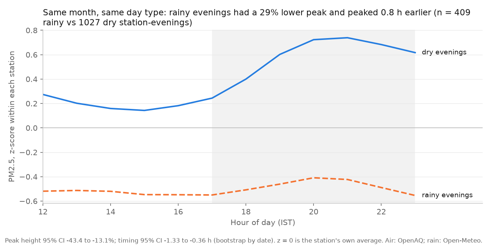{width=14cm}

**Caution.** On rainy days PM2.5 is already far lower at noon, before the rain window starts (chart 2). The
weather systems that bring rain also bring wind and cleaner air. So rain marks cleaner evenings; we do not
claim rain itself causes the drop.

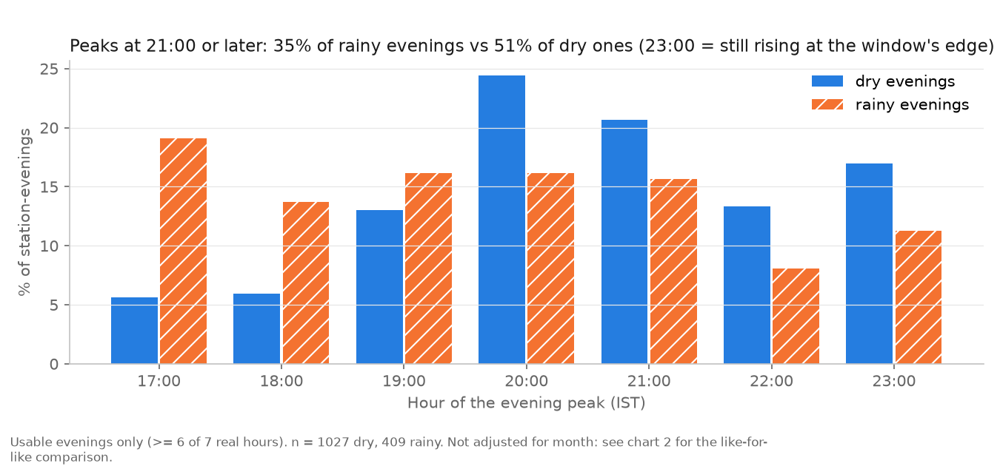{width=11cm}

**Finding 3: the dry season is the problem, not the monsoon.** Evening PM2.5 is highest in
November 2026 (53.3 µg/m³), March 2026
(50.6) and April 2026 (46.5), and lowest
in June 2026 to August 2026 (16.9 to
19.3). November 2026 is
3.2 times
August 2026. Note that November 2026 only has data up to
2026-11-20.

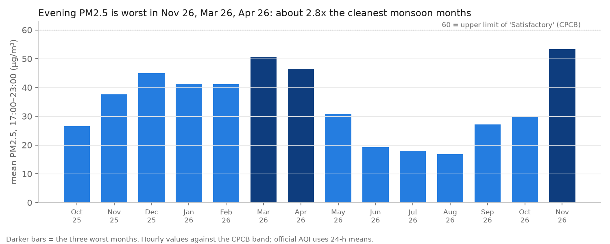{width=12cm}

**Finding 4: Deepavali night is the single worst evening.** From 19:00 to 23:00 on Deepavali (20 October
2025) the city averaged 76.7 µg/m³, against 32.5 on
6 matched normal evenings (same weekday and month, no festival), that is
136% higher. The flat stretch at 20:00, 21:00 is not real: no station sent data in those hours and the 19:00 value was carried forward under our 3-hour rule, so the true evening average may be higher still. For contrast,
on the wettest day (2025-10-09, 34.4 mm) the evening averaged
18.5 µg/m³ against 25.8 on matched days.

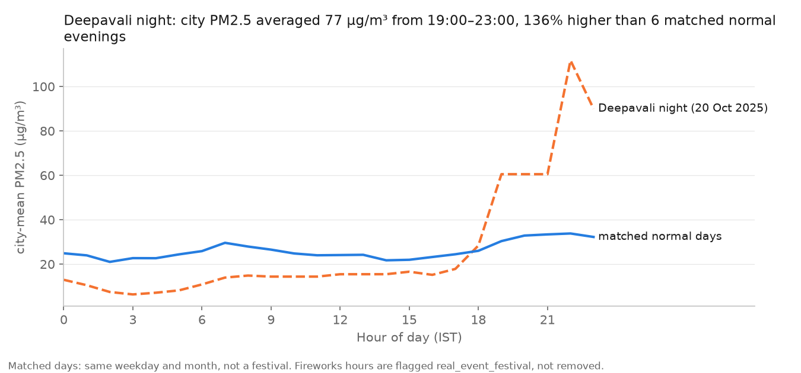{width=12cm}

**Finding 5 (context): residents search for the weather and the air when it changes, not for traffic.**
Weekly Google Trends interest in Karnataka (59 weeks; chart 7 in Appendix E) rises with the week's rain
for "bangalore rain" (Spearman rho = +0.62) and with the week's
evening PM2.5 for "AQI bangalore" (rho = +0.52), while
"bangalore traffic" follows neither (+0.03 and
-0.09). Searches are weekly and relative, so this is a sign
that people notice bad-air weeks, not evidence about any single evening.


# g. Recommendation

1. **Time evening pollution alerts for 19:00 to 22:00, and send them by 18:00.** That window holds
   65.3% of evening peaks, and the rise starts around 18:00. Alerts sent later miss
   the build-up.
2. **Focus alerts on the dry season and festival nights.** Prioritise November to April (November, March, April were the
   worst months) and add a standing festival-night alert for Deepavali, when the evening level was more than
   double a normal evening.
3. **Do not plan a later "rainy-day" alert schedule.** On rainy evenings the peak came earlier and lower, not
   later. Rain-day rules for delivery riders and office hours should be set for road safety and traffic; our
   data give no reason to move pollution measures later on those days.
4. **Do not target specific weekdays.** Once festivals are excluded no weekday differs by more than chance.
   One evening rule for all seven days is simpler and fits the evidence.
5. **Add monitors where the data are blind.** All 7 stations sit within 13 km of the centre; Whitefield,
   Electronic City and Yelahanka have none in our data (chart 6). Before targeting neighbourhoods, the city
   needs readings from them.

How serious is the evening rush overall? Of evening station-hours, 53.4% fall in CPCB's "Good"
band and 34.8% in "Satisfactory", while 2.5% reach "Poor" or worse (hourly
readings against the 24-hour bands, so only an indication). The rush matters most on the dry-season and
festival evenings named above.


# h. Limitations and bias

* **Sensor coverage.** Only 7 reference monitors met our coverage rule, all within 13 km of the city
  centre and mostly in the south and centre. The outer growth areas (Whitefield, Electronic City,
  Yelahanka) have no station in our data, so our "city" curve describes the core, not the whole city.
  Residents of the outer city are left out.

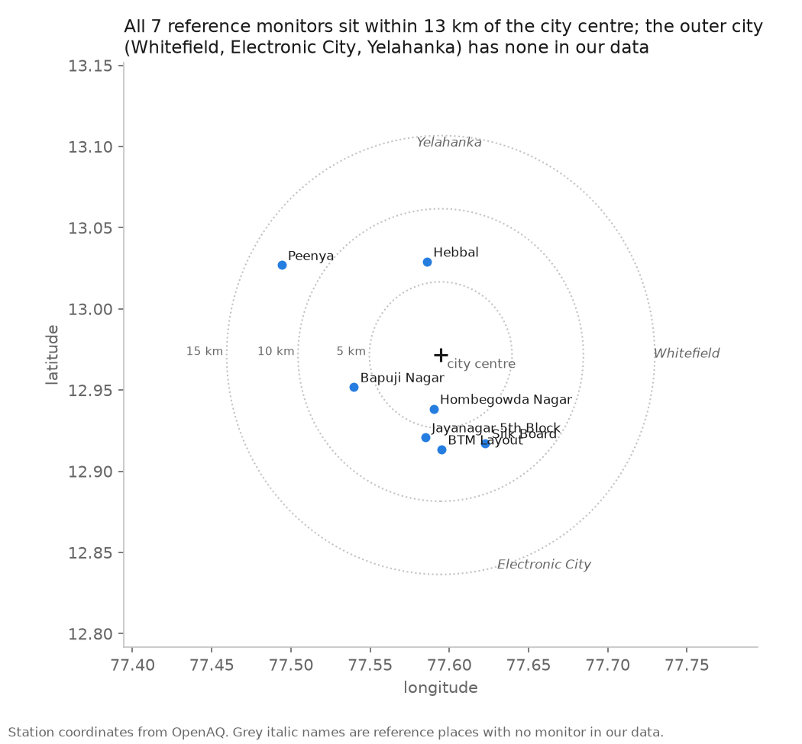{width=9cm}

* **Gaps.** PM2.5 was missing for 14.5% to 38.3% of hours depending on the station, including a two-week
  outage at all stations in January 2026. 872 station-evenings were too incomplete to time the peak.
  If the missing evenings are not random (for example, sensors failing more in heavy rain), our results could
  be biased.
* **One weather point.** Rain comes from a single Open-Meteo grid point at the city centre. A storm over
  Peenya may not register there, so some "dry" evenings may have been wet locally.
* **Correlation, not cause.** Rainy days are cleaner already at noon. Wind, cloud and the weather system all
  change together, and fewer people go out in the rain. We cannot separate these with our data.
* **Hourly averages.** Each value is the average of four 15-minute readings, and alerts based on CPCB's
  24-hour AQI bands are an indication only.
* **Unit conversion.** NO2 and CO were converted from ppb at a standard 25 °C and 1 atm; Bengaluru's
  real temperature and altitude shift these by a few percent. PM2.5, our main measure, needed no conversion.
* **Search data.** Google Trends shows what people **search**, not what they experience; searchers skew towards younger, online, English-typing residents, and the values are weekly and relative (0 to 100), so they can only give context.
* **Sources we did not use.** We did not use Reddit or Kaggle data. Reddit posters are a small, younger,
  English-speaking group and would not represent the city; Kaggle traffic or delivery datasets rarely say how
  or where they were collected, so we could not check their origin. We therefore say nothing about traffic
  volumes directly; "traffic" in this report is an explanation from outside our data, not a measurement.


# i. Reflection

**How the question changed.** We started by expecting rain to **delay** the evening peak, because wet roads
slow traffic. The data reversed this: rainy evenings peaked earlier and lower. Our first SQL query on peak
timing (20:00 most common, but 23:00 (the window's edge) second) showed that many evenings have no clear "8 PM" peak, so we now report edge peaks
separately. Our first weekday table named Monday the worst; that turned out to be the Deepavalis, and a
proper test showed no weekday stands out. The data also changed our plan: only 5 stations reached 70%
coverage, so we accepted 60% and a stricter per-evening rule instead.

**What we would do with better data.**

More monitors in the outer city; rain gauges at each station instead of one city-centre point; hourly
traffic counts or metro ridership, so "traffic" becomes a measurement rather than an explanation; and several
years of data, so a "worst month" can be checked against other years.

[[TODO-HUMAN: rewrite this section in the team's own words (it is graded as your reflection); keep the
facts from report/reflection_notes.md, and add one thing each member learned.]]


```{=openxml}
<w:p><w:r><w:br w:type="page"/></w:r></w:p>
```

# Appendix A. Full cleaning log, gaps per station and data inventory

| # | Stage | Problem found | Rows affected | Action taken | Why |
|---|---|---|---|---|---|
| 1 | 01_find_stations | Locations in the Bengaluru box are a mix of reference monitors, low-cost sensors and locations without PM2.5 | 11 | Kept only fixed reference monitors with a PM2.5 sensor | Low-cost and mobile sensors measure differently; mixing them compares unlike things |
| 2 | 01_find_stations | Stations list several PM2.5 sensor ids; old ids have no data in our range (OpenAQ re-issued sensor ids) | 11 | Treat all ids of one location as one station; per day take the id that reported | Otherwise one station would look like two, one of them empty |
| 3 | 01_find_stations | Monitors below 60% PM2.5 coverage for the study range | 7 | Dropped; kept 7 stations with coverage >= 60% | Too few complete evenings to time the evening peak; 70% left only 5 stations, so the team chose 60% (M5) |
| 4 | 02_collect_openaq | Approved stations also list sensor ids for our pollutants whose last reading is before 2025-10-01 | 28 | Skipped these old ids when downloading | They only return empty pages; the station's new id carries the data |
| 5 | 05_flatten_json | OpenAQ hourly records are nested JSON (32 columns after json_normalize: parameter, period, summary, coverage objects) | 204,584 | Flattened with pd.json_normalize; kept 8 columns + station/sensor ids | Tables and SQL need one value per cell; summary quantiles are not used in our question |
| 6 | 05_flatten_json | Open-Meteo sends parallel arrays (time[], rain[], ...) instead of records | 9,984 | Turned each array into a column with pd.DataFrame | Different JSON shape from OpenAQ; both must end up as one row per hour |
| 7 | 06_time_and_types | OpenAQ timestamps are ISO-8601 text in UTC ('...Z'), plus a second local copy with a '+05:30' offset | 204,584 | Parsed UTC with pd.to_datetime(utc=True) and converted to IST (Asia/Kolkata); 0 unparseable | MySQL and our charts need one clock; the commissioner thinks in IST |
| 8 | 06_time_and_types | Need proof that our UTC->IST conversion is right | 0 | Compared our IST with OpenAQ's own '+05:30' local time; rows_affected = mismatches | An independent check: 0 mismatches means the conversion is correct |
| 9 | 06_time_and_types | OpenAQ hours start at :30 UTC, i.e. on the hour in IST | 0 | Checked every ts_ist falls on :00 IST; rows_affected = rows that do not | Confirms each reading is the average for the IST hour starting at ts_ist |
| 10 | 06_time_and_types | Values must be numbers; text values would break averages | 0 | pd.to_numeric(errors='coerce') then float64; rows_affected = text values turned missing | OpenAQ JSON already sends numbers (33 were null on arrival); the cast guards against text from CPCB files if we add them |
| 11 | 06_time_and_types | NO2 arrives in ppb, but Indian AQI breakpoints use µg/m³ | 51,290 | Converted: value x 1.88162 (MW 46.0055 / 24.45, at 25 C, 1 atm) | Same units as the CPCB AQI table; 25 C/1 atm is the standard reference condition |
| 12 | 06_time_and_types | CO arrives in ppb, but Indian AQI breakpoints use mg/m³ | 48,952 | Converted: value x 0.00115 (MW 28.01 / 24.45 / 1000, at 25 C, 1 atm) | Same units as the CPCB AQI table; 25 C/1 atm is the standard reference condition |
| 13 | 06_time_and_types | Same station, parameter and IST hour appears more than once (0 rows involved; month-boundary hours or overlapping sensor ids) | 0 | Kept one row per key, preferring the higher observed_count | A duplicate would count that hour twice in every average |
| 14 | 06_time_and_types | Open-Meteo times are text with NO zone ('2025-10-01T00:00'); GMT because we requested timezone=GMT | 9,984 | Parsed, labelled as UTC (tz_localize), converted to IST (tz_convert) | Doing the conversion ourselves makes it visible and checkable, not hidden in the API |
| 15 | 06_time_and_types | Weather hours start at :30 IST; air-quality hours start at :00 IST | 9,984 | Instantaneous vars: value at the half-hour label (= middle of the IST hour). Rain: average of the two overlapping hourly totals x 2 halves; 1 edge hour(s) left missing | Joining on the raw labels would match every air reading with weather 30 minutes off |
| 16 | 06_time_and_types | Need a yes/no rain flag per hour | 1,599 | is_rain_hour = precip_mm >= 0.1; rows_affected = rain hours | 0.1 mm is the smallest measurable rainfall on a standard rain gauge |
| 17 | 06_time_and_types | Sanity check of the IST conversion | 51,290 | Mean NO2 by IST hour peaks at 7:00 (morning) and 19:00 (evening); saved outputs/tables/ist_sanity_check.csv | Traffic NO2 should peak in the rush hours; plausible IST peaks support the conversion |
| 18 | 07_gaps_outliers | Hours the API never sent, after building the full hourly grid (279,552 station-parameter-hours) | 75,136 | Counted per station and parameter (outputs/tables/gaps_per_station.csv) | Gaps must be visible before any rule touches them; silent dropping hides bias |
| 19 | 07_gaps_outliers | Longest PM2.5 gap: 1491 hours (~62 days) at BLR5607 | 1,491 | Not filled (far beyond the 3-hour limit); those evenings drop out of peak timing | Inventing days of data would be fabrication |
| 20 | 07_gaps_outliers | Sensor error codes 999 / 9999 | 0 | qc_flag = 'sentinel'; value blanked (treated as a gap) | Loggers write these when the analyser fails; not air |
| 21 | 07_gaps_outliers | Values above the analyser's measuring range | 1 | qc_flag = 'out_of_range'; value blanked (treated as a gap) | Physically not measurable; an error code |
| 22 | 07_gaps_outliers | Negative concentrations | 0 | qc_flag = 'negative'; value blanked (treated as a gap) | A concentration cannot be below zero; usually a calibration drift |
| 23 | 07_gaps_outliers | Exact zero readings | 877 | qc_flag = 'zero'; value blanked (treated as a gap) | Bengaluru city air is never exactly zero for these pollutants |
| 24 | 07_gaps_outliers | Flat-lines: same value repeated for >= 6 hours (CO >= 12) | 1,720 | qc_flag = 'flatline'; value blanked (treated as a gap) | A working sensor jitters; an exact repeat for hours means it is stuck |
| 25 | 07_gaps_outliers | Single-hour spikes (> 5x both neighbours and a large jump) NOT on a festival night or in heavy rain | 10 | qc_flag = 'spike'; value blanked | Real pollution builds and fades over hours; one isolated hour that jumps and drops back is a glitch |
| 26 | 07_gaps_outliers | Extreme values (above each station's 99.5th percentile): real_event_festival | 145 | Kept; qc_flag = 'real_event_festival' | Fireworks on festival nights (e.g. Deepavali) are real pollution |
| 27 | 07_gaps_outliers | Extreme values (above each station's 99.5th percentile): real_event_rain | 0 | Kept; qc_flag = 'real_event_rain' | Extreme values during >= 10 mm/h rain: real weather, kept for the event study |
| 28 | 07_gaps_outliers | Extreme values (above each station's 99.5th percentile): real_event_citywide | 65 | Kept; qc_flag = 'real_event_citywide' | >= 3 stations extreme in the same hour: the air itself, not one sensor |
| 29 | 07_gaps_outliers | Extreme values (above each station's 99.5th percentile): extreme_unexplained | 806 | Kept; qc_flag = 'extreme_unexplained' | Above the 99.5th percentile, no festival/rain/city-wide match: kept but sent to manual review (M11) |
| 30 | 07_gaps_outliers | Manual review (M11) of 10 flagged PM2.5 hours: verdict applied to the whole high-value episode around each | 21 | Episodes judged sensor failures: qc_flag = 'failure_reviewed', value blanked | A human looked at build-up, other stations, rain and festivals (see report/reflection_notes.md) |
| 31 | 07_gaps_outliers | Manual review (M11): episodes judged real events | 5 | qc_flag = 'real_event_reviewed'; kept | Real extreme air must stay in the data, or we would understate the worst evenings |
| 32 | 07_gaps_outliers | Short gaps (<= 3 consecutive hours) in pollutant series | 12,612 | Forward-filled, limit 3 hours; is_filled = True on every filled value | Keeps hourly averages from losing whole hours to brief dropouts, without inventing long stretches |
| 33 | 07_gaps_outliers | Gaps longer than 3 hours | 65,152 | Left missing (not filled) | Beyond 3 hours we would be guessing |
| 34 | 07_gaps_outliers | Station-evenings with fewer than 6 of 7 real PM2.5 hours (out of 2,912 station-evenings) | 872 | Excluded from peak-timing analysis (evening_usable = False); kept for averages | With 2+ evening hours missing we cannot tell WHEN the peak happened |
| 35 | 07_gaps_outliers | Missing hours in smooth weather variables (temperature, humidity, wind, boundary layer) | 0 | Linear interpolation, at most 3 hours | These change smoothly hour to hour, so a straight line is a fair estimate |
| 36 | 07_gaps_outliers | Missing rain hours | 1 | Not filled | Rain starts and stops suddenly; interpolating would invent showers |
| 37 | 08_spark_job | Rows with no usable value (never sent, or blanked as a sensor failure) | 65,612 | Filtered out in Spark before aggregating | An empty or failed reading must not pull averages towards zero |
| 38 | 08_spark_job | Joining PM2.5 hours to weather and calendar | 0 | Left joins keep all 55,026 PM2.5 rows; rows_affected = rows that found no weather (0) or no calendar day (0) | A left join never silently drops air-quality hours; unmatched rows are counted |
| 39 | 05b_load_trends | Google Trends writes very low interest as the text '<1' | 0 | Replaced '<1' with 0.5, then cast the column from text to float | Numbers stored as text cannot be averaged; 0.5 is the middle of 'between 0 and 1' |
| 40 | 05b_load_trends | Trends values that are still not numbers after casting | 0 | Left missing | Nothing to guess from |

**Gaps per station and pollutant** (before any filling):

| Station | Pollutant | Hours expected | Hours missing | % missing | Longest gap (h) |
|---|---|---|---|---|---|
| BLR5548 | co | 9984 | 4743 | 47.5 | 2544 |
| BLR5548 | no2 | 9984 | 3187 | 31.9 | 999 |
| BLR5548 | pm10 | 9984 | 3292 | 33.0 | 999 |
| BLR5548 | pm25 | 9984 | 3209 | 32.1 | 999 |
| BLR5607 | co | 9984 | 3289 | 32.9 | 1491 |
| BLR5607 | no2 | 9984 | 3330 | 33.4 | 1491 |
| BLR5607 | pm10 | 9984 | 5007 | 50.2 | 1492 |
| BLR5607 | pm25 | 9984 | 3822 | 38.3 | 1491 |
| BLR6973 | co | 9984 | 1481 | 14.8 | 242 |
| BLR6973 | no2 | 9984 | 2091 | 20.9 | 300 |
| BLR6973 | pm10 | 9984 | 1481 | 14.8 | 242 |
| BLR6973 | pm25 | 9984 | 1443 | 14.5 | 242 |
| BLR6974 | co | 9984 | 2851 | 28.6 | 1281 |
| BLR6974 | no2 | 9984 | 2726 | 27.3 | 1290 |
| BLR6974 | pm10 | 9984 | 3105 | 31.1 | 1281 |
| BLR6974 | pm25 | 9984 | 2912 | 29.2 | 1281 |
| BLR6975 | co | 9984 | 3679 | 36.8 | 538 |
| BLR6975 | no2 | 9984 | 3059 | 30.6 | 382 |
| BLR6975 | pm10 | 9984 | 2222 | 22.3 | 242 |
| BLR6975 | pm25 | 9984 | 2185 | 21.9 | 242 |
| BLR6983 | co | 9984 | 1400 | 14.0 | 242 |
| BLR6983 | no2 | 9984 | 1680 | 16.8 | 242 |
| BLR6983 | pm10 | 9984 | 1461 | 14.6 | 242 |
| BLR6983 | pm25 | 9984 | 1462 | 14.6 | 242 |
| BLR6984 | co | 9984 | 3528 | 35.3 | 1086 |
| BLR6984 | no2 | 9984 | 2573 | 25.8 | 242 |
| BLR6984 | pm10 | 9984 | 1857 | 18.6 | 248 |
| BLR6984 | pm25 | 9984 | 2061 | 20.6 | 242 |

**Full data inventory** (every field, with a real example value):

| Field | Table | Example | Measurement level | Structure | Source |
|---|---|---|---|---|---|
| station_id | stations | BLR6973 | nominal | structured | our key from OpenAQ location id |
| name | stations | Jayanagar 5th Block, Bengaluru - KSPCB | nominal | structured | OpenAQ v3 API (JSON) |
| lat | stations | 12.92 | continuous | structured | OpenAQ v3 API (JSON) |
| lon | stations | 77.58 | continuous | structured | OpenAQ v3 API (JSON) |
| operator | stations | Karnataka State Pollution Control Board | nominal | structured | OpenAQ v3 API (JSON) |
| openaq_location_id | stations | 6973 | nominal (a number used as a label) | structured | OpenAQ v3 API (JSON) |
| ts_ist | readings | 2025-10-12 20:00:00 | continuous (interval scale: time) | semi-structured (nested JSON text) | OpenAQ v3 API (JSON) |
| parameter | readings | co | nominal | semi-structured | OpenAQ v3 API (JSON) |
| value | readings | 0.00 | continuous (ratio) | semi-structured | OpenAQ v3 API (JSON) |
| unit | readings | mg/m³ | nominal | semi-structured | OpenAQ v3 API (JSON) |
| qc_flag | readings | ok | nominal | structured | derived (07_gaps_outliers.py) |
| is_filled | readings | False | nominal (binary) | structured | derived (07_gaps_outliers.py) |
| observed_count | readings | 3 | discrete (0-4 quarter-hours) | semi-structured | OpenAQ v3 API (JSON) |
| ts_ist | weather_hourly | 2025-10-01 05:00:00 | continuous (interval scale: time) | semi-structured (JSON arrays) | Open-Meteo archive API (JSON) |
| precip_mm | weather_hourly | 0.00 | continuous (ratio) | semi-structured | Open-Meteo archive API (JSON) |
| rain_mm | weather_hourly | 0.00 | continuous (ratio) | semi-structured | Open-Meteo archive API (JSON) |
| temp_c | weather_hourly | 19.60 | continuous (interval) | semi-structured | Open-Meteo archive API (JSON) |
| rh_pct | weather_hourly | 94.00 | continuous (ratio, 0-100) | semi-structured | Open-Meteo archive API (JSON) |
| wind_kmh | weather_hourly | 9.70 | continuous (ratio) | semi-structured | Open-Meteo archive API (JSON) |
| blh_m | weather_hourly | 500.00 | continuous (ratio) | semi-structured | Open-Meteo archive API (JSON) |
| is_rain_hour | weather_hourly | False | nominal (binary) | structured | derived: precip_mm >= 0.1 |
| date | calendar | 2025-10-01 | continuous (interval scale: time) | structured | Karnataka/central holiday lists (CSV we built) |
| weekday | calendar | Wednesday | ordinal (ordered, repeats weekly) | structured | Karnataka/central holiday lists (CSV we built) |
| is_holiday | calendar | True | nominal (binary) | structured | Karnataka/central holiday lists (CSV we built) |
| holiday_name | calendar | Mahanavami / Ayudha Pooja | nominal | unstructured (free text names) | Karnataka/central holiday lists (CSV we built) |
| is_long_weekend | calendar | False | nominal (binary) | structured | derived: 3+ days off in a row |
| is_festival | calendar | True | nominal (binary) | structured | Karnataka/central holiday lists (CSV we built) |
| season | calendar | post_monsoon | nominal (cyclic, no natural first) | structured | derived: IMD seasons by month |
| aqi_category | analysis | Moderate | ORDINAL (Good < Satisfactory < Moderate < Poor < Very Poor < Severe) | structured | derived: CPCB PM2.5 breakpoints, applied hourly |
| pm25_z | analysis | 1.84 | continuous (unitless) | structured | derived: z-score within station |
| peak_hour | analysis | 20 | discrete (17-23) | structured | derived: hour of the evening maximum |
| evening_type | analysis | rainy | nominal (rainy / dry / other) | structured | derived from weather |
| search_interest | trends | 0-100 index | discrete (relative index 0-100) | structured export of unstructured search text | Google Trends (manual CSV, M7) |


# Appendix B. Database: ER diagram, schema and queries

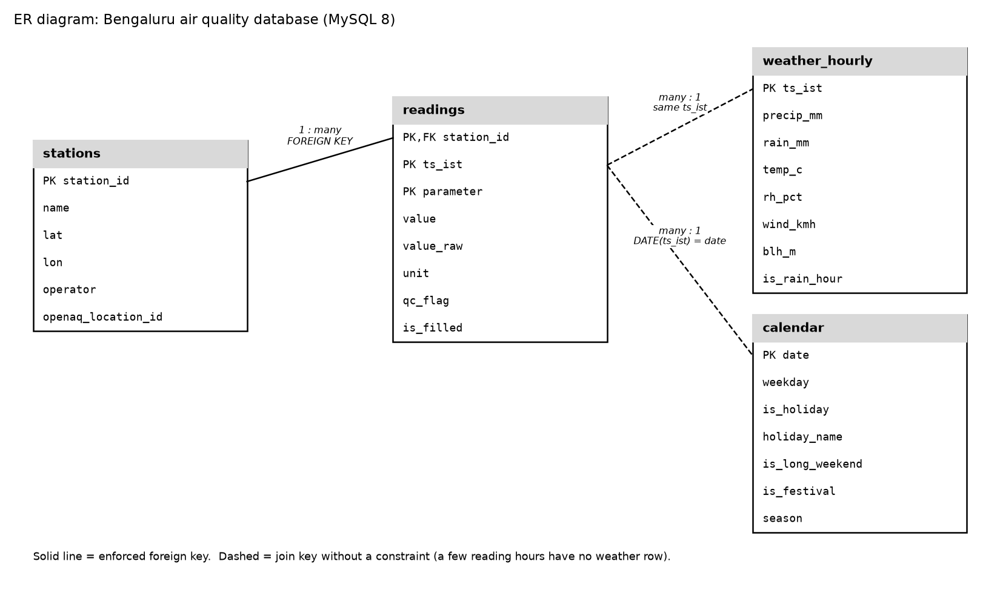{width=15cm}

The schema is in `sql/schema.sql`; the queries in `sql/queries.sql` are run by `src/09_load_mysql.py`, which
saves their outputs below (also in `outputs/tables/sql_q1.csv` to `sql_q7.csv`).


### Q1: How big is each table? (the V profile quotes these numbers)

```sql
SELECT 'stations' AS table_name, COUNT(*) AS n_rows FROM stations
UNION ALL SELECT 'readings', COUNT(*) FROM readings
UNION ALL SELECT 'weather_hourly', COUNT(*) FROM weather_hourly
UNION ALL SELECT 'calendar', COUNT(*) FROM calendar
```

| table_name     |   n_rows |
|:---------------|---------:|
| stations       |        7 |
| readings       |   279552 |
| weather_hourly |     9984 |
| calendar       |      416 |

### Q2: Gaps per station (JOIN + GROUP BY). How many PM2.5 hours have no usable value?

```sql
SELECT s.name,
       COUNT(*)                                          AS hours_in_range,
       SUM(r.value IS NULL)                              AS hours_without_value,
       ROUND(100 * SUM(r.value IS NULL) / COUNT(*), 1)   AS pct_without_value
FROM readings AS r
JOIN stations AS s ON s.station_id = r.station_id
WHERE r.parameter = 'pm25'
GROUP BY s.name
ORDER BY pct_without_value DESC
```

| name                                   |   hours_in_range |   hours_without_value |   pct_without_value |
|:---------------------------------------|-----------------:|----------------------:|--------------------:|
| Peenya, Bengaluru - CPCB               |             9984 |                  4097 |                41   |
| BTM Layout, Bengaluru - CPCB           |             9984 |                  2884 |                28.9 |
| Bapuji Nagar, Bengaluru - KSPCB        |             9984 |                  2519 |                25.2 |
| Silk Board, Bengaluru - KSPCB          |             9984 |                  1604 |                16.1 |
| Hebbal, Bengaluru - KSPCB              |             9984 |                  1540 |                15.4 |
| Hombegowda Nagar, Bengaluru - KSPCB    |             9984 |                  1132 |                11.3 |
| Jayanagar 5th Block, Bengaluru - KSPCB |             9984 |                   966 |                 9.7 |

### Q3: The heatmap in SQL (GROUP BY hour x weekday). Mean PM2.5 for each weekday

```sql
SELECT WEEKDAY(r.ts_ist)        AS weekday_num,
       DAYNAME(r.ts_ist)        AS weekday,
       HOUR(r.ts_ist)           AS hour_ist,
       ROUND(AVG(r.value), 1)   AS mean_pm25,
       COUNT(r.value)           AS n_station_hours
FROM readings AS r
WHERE r.parameter = 'pm25'
  AND r.value IS NOT NULL
  AND HOUR(r.ts_ist) BETWEEN 17 AND 23
GROUP BY weekday_num, weekday, hour_ist
ORDER BY weekday_num, hour_ist
```

|   weekday_num | weekday   |   hour_ist |   mean_pm25 |   n_station_hours |
|--------------:|:----------|-----------:|------------:|------------------:|
|             0 | Monday    |         17 |        29.7 |               315 |
|             0 | Monday    |         18 |        33.2 |               323 |
|             0 | Monday    |         19 |        37.1 |               327 |
|             0 | Monday    |         20 |        39   |               326 |
|             0 | Monday    |         21 |        39.7 |               320 |
|             0 | Monday    |         22 |        39.9 |               324 |
|             0 | Monday    |         23 |        37.4 |               319 |
|             1 | Tuesday   |         17 |        30.6 |               339 |
|             1 | Tuesday   |         18 |        32.5 |               334 |
|             1 | Tuesday   |         19 |        35.3 |               331 |
|             1 | Tuesday   |         20 |        38.1 |               324 |
|             1 | Tuesday   |         21 |        39.2 |               321 |
|             1 | Tuesday   |         22 |        39.1 |               321 |
|             1 | Tuesday   |         23 |        37.1 |               321 |
|             2 | Wednesday |         17 |        30.5 |               348 |
|             2 | Wednesday |         18 |        32.5 |               353 |
|             2 | Wednesday |         19 |        33.9 |               354 |
|             2 | Wednesday |         20 |        35.9 |               354 |
|             2 | Wednesday |         21 |        35.3 |               351 |
|             2 | Wednesday |         22 |        33.8 |               352 |
|             2 | Wednesday |         23 |        32.2 |               343 |
|             3 | Thursday  |         17 |        27.9 |               341 |
|             3 | Thursday  |         18 |        30   |               338 |
|             3 | Thursday  |         19 |        32.8 |               336 |
|             3 | Thursday  |         20 |        34.2 |               336 |
|             3 | Thursday  |         21 |        33.7 |               334 |
|             3 | Thursday  |         22 |        33   |               340 |
|             3 | Thursday  |         23 |        32.6 |               337 |
|             4 | Friday    |         17 |        28.3 |               350 |
|             4 | Friday    |         18 |        32.4 |               350 |

### Q4: Rainy vs dry evening hours (readings JOIN weather_hourly). Mean PM2.5 by IST

```sql
SELECT HOUR(r.ts_ist)          AS hour_ist,
       w.is_rain_hour,
       ROUND(AVG(r.value), 1)  AS mean_pm25,
       COUNT(r.value)          AS n_station_hours
FROM readings AS r
JOIN weather_hourly AS w ON w.ts_ist = r.ts_ist
WHERE r.parameter = 'pm25'
  AND r.value IS NOT NULL
  AND HOUR(r.ts_ist) BETWEEN 17 AND 23
GROUP BY hour_ist, w.is_rain_hour
ORDER BY hour_ist, w.is_rain_hour
```

|   hour_ist |   is_rain_hour |   mean_pm25 |   n_station_hours |
|-----------:|---------------:|------------:|------------------:|
|         17 |              0 |        32.8 |              1687 |
|         17 |              1 |        20.5 |               642 |
|         18 |              0 |        34.5 |              1911 |
|         18 |              1 |        20.8 |               428 |
|         19 |              0 |        37.3 |              1977 |
|         19 |              1 |        21.7 |               358 |
|         20 |              0 |        38.7 |              2057 |
|         20 |              1 |        22.7 |               260 |
|         21 |              0 |        38.9 |              2041 |
|         21 |              1 |        22.7 |               248 |
|         22 |              0 |        37.4 |              2119 |
|         22 |              1 |        20.7 |               179 |
|         23 |              0 |        36.3 |              2023 |
|         23 |              1 |        22.5 |               280 |

### Q5: Three-table join (readings JOIN weather_hourly JOIN calendar).

```sql
SELECT c.season,
       c.is_holiday,
       w.is_rain_hour,
       ROUND(AVG(r.value), 1)  AS mean_evening_pm25,
       COUNT(r.value)          AS n_station_hours
FROM readings AS r
JOIN weather_hourly AS w ON w.ts_ist = r.ts_ist
JOIN calendar       AS c ON c.date = DATE(r.ts_ist)
WHERE r.parameter = 'pm25'
  AND r.value IS NOT NULL
  AND HOUR(r.ts_ist) BETWEEN 17 AND 23
GROUP BY c.season, c.is_holiday, w.is_rain_hour
ORDER BY c.season, c.is_holiday, w.is_rain_hour
```

| season       |   is_holiday |   is_rain_hour |   mean_evening_pm25 |   n_station_hours |
|:-------------|-------------:|---------------:|--------------------:|------------------:|
| post_monsoon |            0 |              0 |                39.4 |              3352 |
| post_monsoon |            0 |              1 |                23.1 |               583 |
| post_monsoon |            1 |              0 |                41.1 |              1625 |
| post_monsoon |            1 |              1 |                26.8 |               276 |
| pre_monsoon  |            0 |              0 |                43.9 |              2115 |
| pre_monsoon  |            0 |              1 |                30   |               142 |
| pre_monsoon  |            1 |              0 |                43.6 |              1266 |
| pre_monsoon  |            1 |              1 |                28.4 |                79 |
| sw_monsoon   |            0 |              0 |                22   |              2225 |
| sw_monsoon   |            0 |              1 |                18.3 |               973 |
| sw_monsoon   |            1 |              0 |                20.6 |              1088 |
| sw_monsoon   |            1 |              1 |                16.7 |               322 |
| winter       |            0 |              0 |                42.1 |              1516 |
| winter       |            0 |              1 |                53.2 |                14 |
| winter       |            1 |              0 |                39   |               628 |
| winter       |            1 |              1 |                18.6 |                 6 |

### Q6: The worst festival nights (readings JOIN calendar JOIN stations).

```sql
SELECT c.date,
       c.holiday_name,
       s.name,
       HOUR(r.ts_ist)  AS hour_ist,
       r.value_raw     AS pm25,
       r.qc_flag
FROM readings AS r
JOIN calendar AS c ON c.date = DATE(r.ts_ist)
JOIN stations AS s ON s.station_id = r.station_id
WHERE r.parameter = 'pm25'
  AND c.is_festival = 1
  AND HOUR(r.ts_ist) >= 18
  AND r.value_raw IS NOT NULL
ORDER BY r.value_raw DESC
LIMIT 10
```

| date       | holiday_name                         | name                                   |   hour_ist |   pm25 | qc_flag             |
|:-----------|:-------------------------------------|:---------------------------------------|-----------:|-------:|:--------------------|
| 2026-11-08 | Naraka Chaturdashi / Deepavali       | Silk Board, Bengaluru - KSPCB          |         21 |    355 | real_event_festival |
| 2026-11-08 | Naraka Chaturdashi / Deepavali       | Silk Board, Bengaluru - KSPCB          |         22 |    304 | real_event_festival |
| 2026-11-08 | Naraka Chaturdashi / Deepavali       | Silk Board, Bengaluru - KSPCB          |         23 |    302 | real_event_festival |
| 2026-11-08 | Naraka Chaturdashi / Deepavali       | Silk Board, Bengaluru - KSPCB          |         20 |    285 | real_event_festival |
| 2026-11-08 | Naraka Chaturdashi / Deepavali       | Jayanagar 5th Block, Bengaluru - KSPCB |         20 |    251 | real_event_festival |
| 2026-11-09 | Govardhan Puja (Deepavali)           | Jayanagar 5th Block, Bengaluru - KSPCB |         20 |    250 | real_event_festival |
| 2026-11-09 | Govardhan Puja (Deepavali)           | Jayanagar 5th Block, Bengaluru - KSPCB |         19 |    244 | real_event_festival |
| 2026-11-09 | Govardhan Puja (Deepavali)           | Hebbal, Bengaluru - KSPCB              |         21 |    226 | real_event_festival |
| 2025-10-21 | Deepavali (Lakshmi Pooja / Amavasya) | Jayanagar 5th Block, Bengaluru - KSPCB |         21 |    221 | real_event_festival |
| 2026-11-10 | Balipadyami, Deepavali               | Jayanagar 5th Block, Bengaluru - KSPCB |         22 |    216 | real_event_festival |

### Q7: When does the evening peak happen? (window function, MySQL 8)

```sql
WITH ranked AS (
    SELECT r.station_id,
           DATE(r.ts_ist)  AS day,
           HOUR(r.ts_ist)  AS hour_ist,
           ROW_NUMBER() OVER (PARTITION BY r.station_id, DATE(r.ts_ist)
                              ORDER BY r.value DESC) AS rank_in_evening
    FROM readings AS r
    WHERE r.parameter = 'pm25'
      AND r.value IS NOT NULL
      AND HOUR(r.ts_ist) BETWEEN 17 AND 23
)
SELECT hour_ist      AS peak_hour_ist,
       COUNT(*)      AS n_station_evenings
FROM ranked
WHERE rank_in_evening = 1
GROUP BY hour_ist
ORDER BY hour_ist
```

|   peak_hour_ist |   n_station_evenings |
|----------------:|---------------------:|
|              17 |                  326 |
|              18 |                  226 |
|              19 |                  311 |
|              20 |                  468 |
|              21 |                  400 |
|              22 |                  306 |
|              23 |                  387 |


# Appendix C. Rain-effect regression (fixed effects)

The peak height (log) and peak hour of each station-evening are regressed on a rainy-evening flag, holding
month, day type and station constant; standard errors are clustered by date.

```
PEAK HEIGHT (log)
                            OLS Regression Results                            
==============================================================================
Dep. Variable:               log_peak   R-squared:                       0.474
Model:                            OLS   Adj. R-squared:                  0.466
Method:                 Least Squares   F-statistic:                     59.43
Date:                Thu, 26 Nov 2026   Prob (F-statistic):           3.25e-85
Time:                        19:21:49   Log-Likelihood:                -841.71
No. Observations:                1436   AIC:                             1727.
Df Residuals:                    1414   BIC:                             1843.
Df Model:                          21                                         
Covariance Type:              cluster                                         
==============================================================================================
                                 coef    std err          z      P>|z|      [0.025      0.975]
----------------------------------------------------------------------------------------------
Intercept                      3.6033      0.127     28.450      0.000       3.355       3.852
C(month)[T.2025-11]            0.1727      0.126      1.375      0.169      -0.074       0.419
C(month)[T.2025-12]            0.2639      0.126      2.103      0.035       0.018       0.510
C(month)[T.2026-01]            0.1293      0.127      1.015      0.310      -0.120       0.379
C(month)[T.2026-02]            0.1258      0.128      0.983      0.326      -0.125       0.377
C(month)[T.2026-03]            0.3506      0.125      2.795      0.005       0.105       0.596
C(month)[T.2026-04]            0.2331      0.124      1.880      0.060      -0.010       0.476
C(month)[T.2026-05]           -0.0228      0.146     -0.156      0.876      -0.310       0.264
C(month)[T.2026-06]           -0.1869      0.161     -1.164      0.244      -0.502       0.128
C(month)[T.2026-07]           -0.3532      0.139     -2.547      0.011      -0.625      -0.081
C(month)[T.2026-08]           -0.3131      0.149     -2.101      0.036      -0.605      -0.021
C(month)[T.2026-09]            0.0037      0.134      0.027      0.978      -0.260       0.267
C(month)[T.2026-10]           -0.0467      0.149     -0.314      0.754      -0.339       0.245
C(month)[T.2026-11]            0.4322      0.150      2.884      0.004       0.138       0.726
C(day_type)[T.working_day]     0.0079      0.038      0.207      0.836      -0.067       0.083
C(station_id)[T.BLR5607]      -0.2473      0.048     -5.184      0.000      -0.341      -0.154
C(station_id)[T.BLR6973]       0.3741      0.035     10.639      0.000       0.305       0.443
C(station_id)[T.BLR6974]       0.0155      0.041      0.375      0.707      -0.065       0.096
C(station_id)[T.BLR6975]       0.4153      0.044      9.346      0.000       0.328       0.502
C(station_id)[T.BLR6983]       0.0489      0.039      1.247      0.212      -0.028       0.126
C(station_id)[T.BLR6984]       0.1180      0.042      2.799      0.005       0.035       0.201
rainy                         -0.4264      0.075     -5.719      0.000      -0.573      -0.280
==============================================================================
Omnibus:                      137.542   Durbin-Watson:                   1.147
Prob(Omnibus):                  0.000   Jarque-Bera (JB):              374.832
Skew:                           0.514   Prob(JB):                     4.04e-82
Kurtosis:                       5.282   Cond. No.                         20.2
==============================================================================

Notes:
[1] Standard Errors are robust to cluster correlation (CRV1)

PEAK HOUR
                            OLS Regression Results                            
==============================================================================
Dep. Variable:              peak_hour   R-squared:                       0.090
Model:                            OLS   Adj. R-squared:                  0.077
Method:                 Least Squares   F-statistic:                     5.460
Date:                Thu, 26 Nov 2026   Prob (F-statistic):           6.57e-12
Time:                        19:21:49   Log-Likelihood:                -2820.4
No. Observations:                1436   AIC:                             5685.
Df Residuals:                    1414   BIC:                             5801.
Df Model:                          21                                         
Covariance Type:              cluster                                         
==============================================================================================
                                 coef    std err          z      P>|z|      [0.025      0.975]
----------------------------------------------------------------------------------------------
Intercept                     20.7826      0.319     65.224      0.000      20.158      21.407
C(month)[T.2025-11]           -0.1090      0.397     -0.275      0.784      -0.887       0.669
C(month)[T.2025-12]            0.0317      0.306      0.103      0.918      -0.569       0.632
C(month)[T.2026-01]           -0.5054      0.363     -1.391      0.164      -1.217       0.207
C(month)[T.2026-02]           -0.2707      0.332     -0.815      0.415      -0.922       0.381
C(month)[T.2026-03]           -0.1980      0.322     -0.615      0.538      -0.829       0.433
C(month)[T.2026-04]           -0.7157      0.306     -2.338      0.019      -1.316      -0.116
C(month)[T.2026-05]           -0.4001      0.330     -1.212      0.226      -1.047       0.247
C(month)[T.2026-06]           -0.4554      0.385     -1.184      0.236      -1.209       0.298
C(month)[T.2026-07]           -0.7403      0.343     -2.158      0.031      -1.413      -0.068
C(month)[T.2026-08]            0.0415      0.369      0.113      0.910      -0.681       0.764
C(month)[T.2026-09]           -0.3258      0.338     -0.963      0.336      -0.989       0.337
C(month)[T.2026-10]           -0.0690      0.375     -0.184      0.854      -0.803       0.665
C(month)[T.2026-11]            0.1885      0.304      0.620      0.536      -0.408       0.785
C(day_type)[T.working_day]     0.1548      0.131      1.185      0.236      -0.101       0.411
C(station_id)[T.BLR5607]      -0.5977      0.209     -2.865      0.004      -1.007      -0.189
C(station_id)[T.BLR6973]       0.1046      0.188      0.557      0.578      -0.263       0.473
C(station_id)[T.BLR6974]      -0.3918      0.178     -2.203      0.028      -0.740      -0.043
C(station_id)[T.BLR6975]       0.0486      0.195      0.249      0.804      -0.334       0.431
C(station_id)[T.BLR6983]      -0.0101      0.176     -0.057      0.954      -0.356       0.335
C(station_id)[T.BLR6984]       0.0776      0.177      0.438      0.661      -0.270       0.425
rainy                         -0.9179      0.196     -4.693      0.000      -1.301      -0.535
==============================================================================
Omnibus:                       76.528   Durbin-Watson:                   1.737
Prob(Omnibus):                  0.000   Jarque-Bera (JB):               31.269
Skew:                          -0.083   Prob(JB):                     1.62e-07
Kurtosis:                       2.297   Cond. No.                         20.2
==============================================================================

Notes:
[1] Standard Errors are robust to cluster correlation (CRV1)
```


# Appendix D. Spreadsheet vs pandas: one pivot built twice


Both versions use the same input: `data/manual/spreadsheet_export_city_hourly.csv`
(9,385 rows: mean PM2.5 across reporting stations, per hour).

**Automatic check (src/13_compare_spreadsheet.py):** 168 cells (24 hours x 7 weekdays);
168 match within 0.01 µg/m³; 0 missing on one side; largest difference
0.0050 µg/m³. **Result: MATCH.**

| | Spreadsheet (LibreOffice Calc) | pandas |
|---|---|---|
| Time taken | [[TODO-HUMAN: it took approx 25-30 mins.]] | one `pivot_table` line; re-runs in seconds with `make analysis` |
| Row limit | about 1 million rows per sheet; we had to export a 9,385-row city average, not the 279,552-row readings table | no fixed limit; memory is the limit (the full table loads in seconds) |
| Reproducibility | clicks are not recorded; we kept screenshots (report/img/) and wrote the steps in MANUAL_STEPS.md | the code is the record; anyone can re-run it from raw data |
| Error risk | easy to pick the wrong summary (Sum instead of Mean) or a wrong range; weekdays sort alphabetically | errors are in code, so they can be reviewed and tested; same result every run |
| Best for | a quick look and sharing with non-coders | the pipeline, big tables, anything that must be repeated |

[[TODO-HUMAN: he "Mean" option is called "Average" in LibreOffice, the Save As box tried to overwrite the input file, and the terminal stayed busy while LibreOffice was open. Those are exactly the error risks the brief wants compared..]]


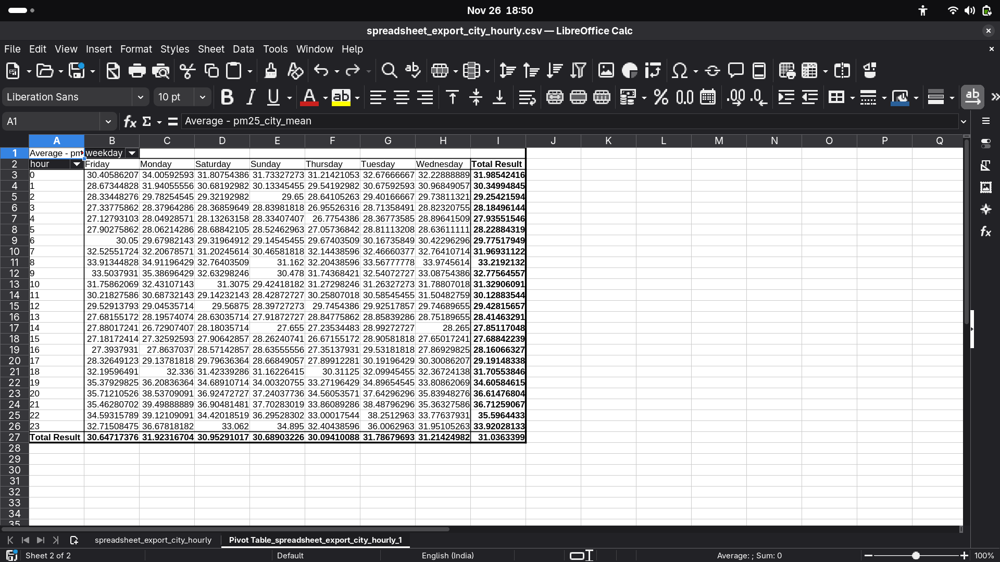{width=15cm}


# Appendix E. Google Trends: weekly search interest

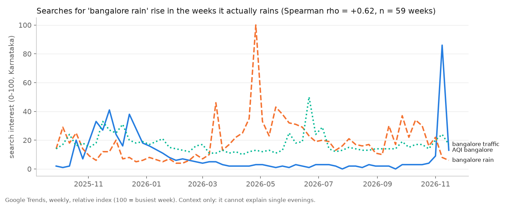{width=16cm}

Exported by hand from trends.google.com (Karnataka, 2025-10-01 to 2026-11-20, all categories, web search):
`data/manual/trends_*.csv`, loaded by `src/05b_load_trends.py`. Google returns weekly values for a range this
long. Correlations with weekly rain and evening PM2.5 are in `outputs/tables/trends_correlation.csv`.


# Appendix F. Use of generative AI

[[TODO-HUMAN: the team fills report/appendix_ai_use.md (tools used, what we asked, what we changed);
it is pasted here when the submission is built.]]
